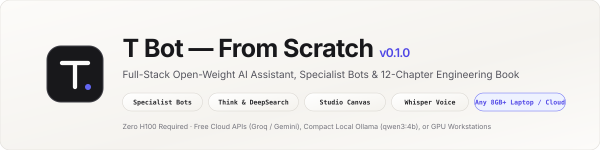
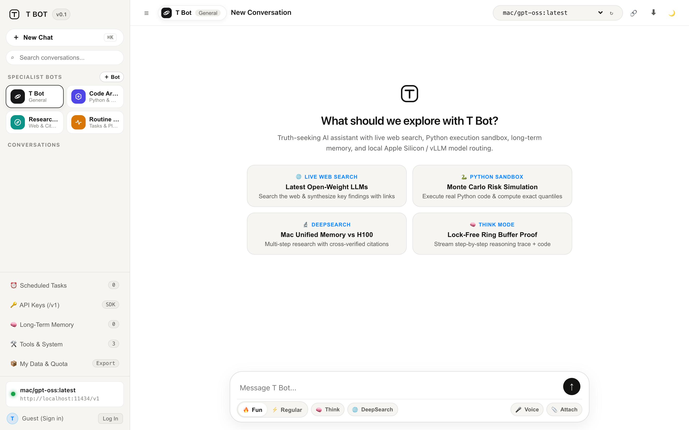

<div align="center">



<br />

[](https://github.com/tradertanmay/grok-from-scratch/releases/tag/v0.1.0)
[](tests/)
[-818cf8?style=flat-square)](docs/book/README.md)
[](pyproject.toml)
[](LICENSE)
[](#pick-models-for-your-machine)

**An open-weight AI assistant and 12-chapter engineering book built from first principles.**

[Get Started](#get-started) · [Hardware Tiers](#pick-models-for-your-machine) · [Read the Book](docs/book/README.md) · [Highlights](#highlights) · [Deploy Guide](docs/DEPLOY.md)

</div>

<br />

<div align="center">
  
</div>

---

## Get Started

```bash
git clone https://github.com/tradertanmay/grok-from-scratch.git
cd grok-from-scratch
python3 -m venv .venv && source .venv/bin/activate
pip install -e ".[dev,mcp]"
```

**Run with a free cloud key (0 GB local VRAM — works on any laptop):**

```bash
LLM_BASE_URL=https://api.groq.com/openai/v1 \
LLM_API_KEY=gsk_your_free_key \
LLM_MODEL=openai/gpt-oss-120b \
GROK_EMBED_MODEL= \
python -m grok_bot
```

**Or run 100% offline with [Ollama](https://ollama.com):**

```bash
ollama pull qwen3:4b
LLM_MODEL=qwen3:4b python -m grok_bot
```

Open **http://127.0.0.1:8000** in your browser, or pass `--cli` for the terminal REPL.

---

## Pick Models for Your Machine

| Your Machine | Setup | Primary Chat | Think / Vision / Voice |
| :--- | :--- | :--- | :--- |
| **Any 8 GB Laptop** *(no GPU, \$0 cloud)* | Free [Groq](https://console.groq.com) / [Gemini](https://aistudio.google.com) key + `GROK_EMBED_MODEL=` *(SQLite FTS5)* | `openai/gpt-oss-120b` *(or `llama-3.3-70b-versatile`)* | `groq/qwen/qwen3.8-27b` · `gemini/gemini-3.8-flash` · `whisper-large-v3-turbo` |
| **8–16 GB Laptop** *(100% offline)* | `ollama pull qwen3:4b qwen3.5:4b nomic-embed-text` | `qwen3:4b` *(2.5 GB)* | `qwen3:4b` · `qwen3.5:4b` *(vision, 3.3 GB)* · Browser Voice / `faster-whisper` |
| **32 GB+ Workstation / GPU** | `ollama pull gpt-oss qwen3.6:35b gemma4:12b` | `gpt-oss:latest` | `qwen3.6:35b` · `gemma4:12b` · `grok_bot.mlx_stt` |

Combine local and cloud models in [`providers.example.json`](providers.example.json) (`cp providers.example.json config/providers.json`) for automatic failover.

---

## 📖 Book: *Building Grok Bot from Scratch*

Every subsystem is paired with a chapter in [`docs/book/`](docs/book/README.md). All **65 code excerpts** are mechanically tested against the live source files on every `pytest` run.

| Ch | Title | Code | Tests |
| :-: | :--- | :--- | :--- |
| **01** | [Architecture, OpenAI Wire Protocol & Multi-Provider Router](docs/book/ch01-architecture-and-llm-client.md) | [`llm.py`](grok_bot/llm.py), [`providers.py`](grok_bot/providers.py) | [`test_providers.py`](tests/test_providers.py) |
| **02** | [ReAct Tool-Use Agent, Sandboxed Python & MCP](docs/book/ch02-agent-loop-tools-and-mcp.md) | [`agent.py`](grok_bot/agent.py), [`python_exec.py`](grok_bot/tools/python_exec.py), [`mcp_client.py`](grok_bot/mcp_client.py) | [`test_agent.py`](tests/test_agent.py), [`test_tools.py`](tests/test_tools.py), [`test_mcp.py`](tests/test_mcp.py) |
| **03** | [Personas, `<think>` Stream Parser & DeepSearch](docs/book/ch03-personas-think-and-deepsearch.md) | [`persona.py`](grok_bot/persona.py), [`deepsearch.py`](grok_bot/deepsearch.py), [`web.py`](grok_bot/tools/web.py) | [`test_modes.py`](tests/test_modes.py) |
| **04** | [Hybrid RAG + SQLite FTS5, Long-Term Memory & Vision](docs/book/ch04-memory-files-rag-and-vision.md) | [`memory.py`](grok_bot/memory.py), [`files.py`](grok_bot/files.py), [`embeddings.py`](grok_bot/embeddings.py) | [`test_memory.py`](tests/test_memory.py), [`test_files.py`](tests/test_files.py) |
| **05** | [Auth, Quotas, Scheduled Tasks & OpenAI `/v1` Gateway](docs/book/ch05-auth-quotas-tasks-and-openai-api.md) | [`auth.py`](grok_bot/auth.py), [`tasks.py`](grok_bot/tasks.py), [`openai_compat.py`](grok_bot/openai_compat.py) | [`test_auth.py`](tests/test_auth.py), [`test_tasks.py`](tests/test_tasks.py), [`test_openai_api.py`](tests/test_openai_api.py) |
| **06** | [Ops, Backups, Prometheus `/metrics` & Eval Harness](docs/book/ch06-ops-backups-metrics-and-evals.md) | [`observability.py`](grok_bot/observability.py), [`backup.py`](grok_bot/backup.py), [`evals`](grok_bot/evals) | [`test_observability.py`](tests/test_observability.py), [`test_backup.py`](tests/test_backup.py), [`test_evals.py`](tests/test_evals.py) |
| **07** | [Streaming Web UI & Sandboxed Grok Studio Canvas](docs/book/ch07-streaming-web-ui-and-canvas.md) | [`index.html`](frontend/index.html), [`app.js`](frontend/app.js), [`styles.css`](frontend/styles.css) | [`test_frontend.py`](tests/test_frontend.py), [`test_chat_ux.py`](tests/test_chat_ux.py) |
| **08** | [Admin Console, API Keys & Account ZIP Portability](docs/book/ch08-admin-tasks-keys-and-portability.md) | [`app.py`](grok_bot/app.py), [`store.py`](grok_bot/store.py) | [`test_admin.py`](tests/test_admin.py), [`test_account.py`](tests/test_account.py), [`test_usage.py`](tests/test_usage.py) |
| **09** | [Voice Mode: Whisper STT & Speech Synthesis](docs/book/ch09-voice-stt-and-tts.md) | [`stt.py`](grok_bot/stt.py), [`mlx_stt.py`](grok_bot/mlx_stt.py) | [`test_transcribe.py`](tests/test_transcribe.py) |
| **10** | [Dataset Curation & 4-Bit LoRA Fine-Tuning (Colab T4 & MLX)](docs/book/ch10-lora-finetuning-mlx-and-unsloth.md) | [`prepare_dataset.py`](training/prepare_dataset.py), [`train_unsloth.py`](training/train_unsloth.py), [`mlx_llm.py`](grok_bot/mlx_llm.py) | [`test_training.py`](tests/test_training.py), [`test_mlx_llm.py`](tests/test_mlx_llm.py) |
| **11** | [Playwright Browser E2E & Async Load Testing](docs/book/ch11-playwright-e2e-and-load-testing.md) | [`loadtest.py`](grok_bot/loadtest.py) | [`test_frontend.py`](tests/test_frontend.py), [`test_loadtest.py`](tests/test_loadtest.py) |
| **12** | [Any-Hardware Production Blueprint](docs/book/ch12-zero-h100-production-blueprint.md) | [`Dockerfile`](Dockerfile), [`compose.yaml`](compose.yaml), [`DEPLOY.md`](docs/DEPLOY.md) | [`test_mlx_llm.py`](tests/test_mlx_llm.py) |

---

## Highlights

| Capability | Built With |
| :--- | :--- |
| **ReAct Agent + MCP** | Parallel tool calls, `<tool_call>` fallback for open models, SSRF-guarded `web_search` / `fetch_url`, `run_python`, and external MCP servers ([`mcp.example.json`](mcp.example.json)). |
| **Think & DeepSearch** | Streaming `<think>` parser, automatic reasoning-model routing (`GROK_THINK_MODEL`), and multi-step citation-verified web research. |
| **Grok Studio Canvas** | Side-by-side live preview and source inspector for `html` / `svg` code blocks inside `<iframe sandbox="allow-scripts">` with strict CSP. |
| **Hybrid RAG & Vision** | Cosine vector search + SQLite `FTS5` BM25 fallback (works with zero embedding model), long-term user memory, and multimodal image analysis. |
| **Voice (STT & TTS)** | `POST /api/transcribe` proxy supporting Free Groq Whisper (`whisper-large-v3-turbo`), local `faster-whisper` / `mlx_stt`, and browser Web Speech API. |
| **OpenAI Gateway** | Drop-in `POST /v1/chat/completions` (`Bearer <key>`) so Cursor, Continue, or the official `openai` SDK can drive the full agent. |
| **Fine-Tuning** | Curate SFT JSONL (`python -m training.prepare_dataset`) and fine-tune 4-bit QLoRA on a free Colab T4 GPU (`train_unsloth.py`) or Apple Silicon (`train_mac_mlx.py`). |
| **Multi-User & Ops** | `scrypt` auth, invite codes, daily quotas, account ZIP export, `/metrics` Prometheus endpoint, and 20-case eval suite (`python -m grok_bot.evals`). |

---

<details>
<summary><b>CLI, REST API & Docker Reference</b></summary>

<br />

### Developer Commands ([`Makefile`](Makefile))

```bash
make check      # ruff check + ruff format --check + pytest -q
make run        # launch web UI on http://127.0.0.1:8000
make eval       # run 20-case evaluation suite (--fast offline mode)
make loadtest   # run 20-user concurrent SSE load test
```

### OpenAI SDK / Cursor Compatibility

```python
from openai import OpenAI

client = OpenAI(base_url="http://127.0.0.1:8000/v1", api_key="local")
resp = client.chat.completions.create(
    model="grok-bot",
    messages=[{"role": "user", "content": "Compute 2**32 using run_python."}],
)
print(resp.choices[0].message.content)
```

### Docker Compose

```bash
cp .env.example .env
# If running Ollama on the host machine, set LLM_BASE_URL=http://host.docker.internal:11434/v1 in .env
docker compose up --build -d
```

See [`docs/DEPLOY.md`](docs/DEPLOY.md) for VPS, Caddy HTTPS, and Cloudflare Tunnel setups, [`SECURITY.md`](SECURITY.md) for sandbox and SSRF details, and [`CONTRIBUTING.md`](CONTRIBUTING.md) for contributor guidelines.

</details>
