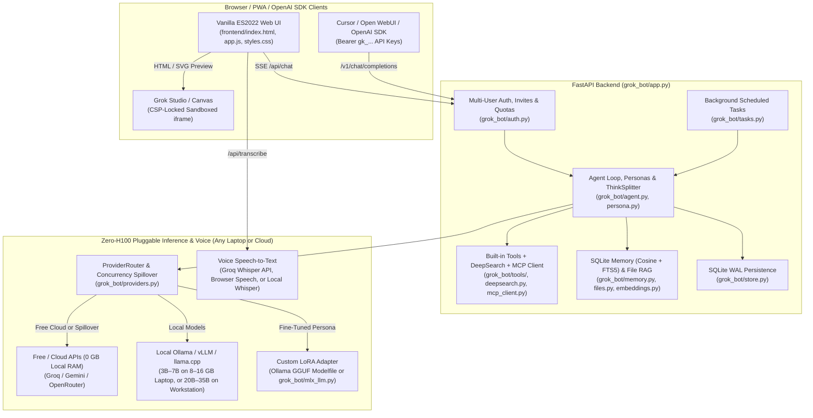

# Building Grok Bot from Scratch

> **A 12-Chapter Hands-On Engineering Book on Designing, Training, and Deploying a Full-Stack AI Assistant on Any Laptop, Free Cloud Tier, or Local GPU — Without Renting an H100**

Welcome to ***Building Grok Bot from Scratch***. Unlike toy tutorials that wrap a single API call in a 50-line script, this book walks you chapter-by-chapter through the exact architecture, source code, database schemas, streaming protocols, MCP tool integration, LoRA fine-tuning pipelines, and load-testing harnesses that power **Grok Bot (`v0.1.0`)**.

Every chapter corresponds directly to production modules in this repository (`grok_bot/`, `frontend/`, `training/`, `grok_bot/evals/`, and `tests/`), labels every code excerpt with its file path and line numbers, verifies every code excerpt against the live codebase via `pytest`, and ends with runnable **Try it** verification commands and **Exercises**.

---

## Works on Any Hardware (No High-End Mac or GPU Required)

You **do not** need an H100 or an expensive 48 GB MacBook to follow this book. Because Grok Bot speaks the standard OpenAI `/v1` wire protocol (`grok_bot/llm.py`, `grok_bot/providers.py`, `grok_bot/stt.py`) and builds in SQLite `FTS5` fallbacks (`grok_bot/memory.py`, `grok_bot/files.py`), every chapter runs on **any laptop or \$5 VPS**:

| Hardware Tier | Chat & Think (`LLM_MODEL`) | Memory & File RAG (`GROK_EMBED_MODEL`) | Voice STT & TTS (`GROK_STT_URL`) | Persona Fine-Tuning (`training/`) |
| :--- | :--- | :--- | :--- | :--- |
| **Tier 1: Any 8 GB Laptop / Windows / Linux / Chromebook (\$0 Free Cloud APIs, 0 GB VRAM)** | Free **Groq** (`groq/openai/gpt-oss-120b`, `groq/qwen/qwen3.8-27b`, `groq/llama-3.3-70b-versatile`) + Free **Google Gemini** (`gemini/gemini-3.8-flash` / `gemini-3.5-flash-lite`) | `GROK_EMBED_MODEL=""` → automatic **SQLite FTS5 BM25 keyword search** (`0 MB` RAM) | Free **Groq Whisper API** (`https://api.groq.com/openai/v1`) or built-in Browser **Web Speech API** | Free **Google Colab T4 GPU (16 GB VRAM)** via `python -m training.train_unsloth` |
| **Tier 2: Everyday 8 GB–16 GB Laptop (Windows / Linux / Base Mac + Ollama)** | Compact local Ollama (`qwen3:4b` `2.5 GB`, `qwen3.5:4b` `3.3 GB` multimodal, `gemma4:e2b` `4.6 GB`) + Cloud spillover for heavy `Think` | Local `nomic-embed-text` (`0.3 GB` RAM) with automatic `FTS5` fallback | Browser Web Speech, Groq Whisper API, or local `whisper-tiny` (`0.15 GB`) | Instant Ollama `Modelfile` (`ollama create grok-persona -f training/Modelfile`) or Free Colab T4 QLoRA |
| **Tier 3: High-RAM Workstation / Local GPU / Apple Silicon (32 GB–48 GB+)** | Local 20B–35B models (`gpt-oss:latest`, `qwen3.6:35b`, `gemma4:12b`) + Cloud burst spillover | Local `nomic-embed-text` (`0.3 GB`) | Local `faster-whisper` or `grok_bot.mlx_stt` (`whisper-large-v3-turbo`) | Local QLoRA (`train_unsloth.py` or `train_mac_mlx.py` + `grok_bot.mlx_llm`) |

---

## System Architecture at a Glance



---

## Table of Contents

### Part I — Core Agent, Storage, APIs & Operations (Chapters 1–6)
1. **[Chapter 1 — Architecture, Streaming and Multi-Provider Routing](ch01-architecture-and-llm-client.md)**
   - System map, `OpenAICompatClient` streaming deltas (`grok_bot/llm.py`), and `ProviderRouter` (`grok_bot/providers.py`)
   - Fast connect timeout (`GROK_CONNECT_TIMEOUT`), 30-second down-provider cooldown, concurrency spillover (`max_concurrent`), and `served_model` attribution
2. **[Chapter 2 — The Agent Loop, Built-in Tools and MCP](ch02-agent-loop-tools-and-mcp.md)**
   - `Tool` and `ToolRegistry`, `Agent.run` multi-step loop, and `<tool_call>` XML fallback parsing (`grok_bot/agent.py`)
   - SSRF-guarded `fetch_url`, Docker/ulimit-sandboxed `python_exec`, and external MCP servers (`grok_bot/mcp_client.py`)
3. **[Chapter 3 — Personas, Think Mode and Iterative DeepSearch](ch03-personas-think-and-deepsearch.md)**
   - `system_prompt` (`Fun Mode` vs. `Regular Mode`), live UTC clock injection, and `ThinkSplitter` (`grok_bot/persona.py`)
   - Think/vision model routing and iterative multi-query `DeepSearch` (`grok_bot/deepsearch.py`)
4. **[Chapter 4 — Long-Term Memory, File Uploads, Hybrid RAG and Vision](ch04-memory-files-rag-and-vision.md)**
   - `SafeEmbedder` (`grok_bot/embeddings.py`), `Memory` recall (cosine similarity with `FTS5` fallback in `grok_bot/memory.py`)
   - Document chunking, `Files.context` (`grok_bot/files.py`), untrusted-attachment delimiters, and base64 image vision
5. **[Chapter 5 — Auth, Quotas, Scheduled Tasks and the OpenAI-Compatible `/v1` API](ch05-auth-quotas-tasks-and-openai-api.md)**
   - `scrypt` password hashing + `DUMMY_HASH` timing defense, first-user admin bootstrap, and invite codes (`grok_bot/auth.py`)
   - `gk_...` API keys, `RateLimiter`, daily message quotas, `next_run`/`run_due_tasks` (`grok_bot/tasks.py`), and `/v1/chat/completions` (`grok_bot/openai_compat.py`)
6. **[Chapter 6 — Production Ops: Docker, Backups, Prometheus Metrics and Evals](ch06-ops-backups-metrics-and-evals.md)**
   - Docker Compose + Caddy TLS, online SQLite `sqlite3.Connection.backup()` + retention pruning (`grok_bot/backup.py`)
   - `Metrics` counters (`grok_bot/observability.py`) and the 16-case evaluation harness (`grok_bot/evals/runner.py`)

### Part II — Frontend UX, Canvas, Voice, Fine-Tuning & Verification (Chapters 7–12)
7. **[Chapter 7 — Zero-Build Streaming SPA, Stop/Regenerate & the CSP-Sandboxed Grok Canvas](ch07-streaming-web-ui-and-canvas.md)**
   - Reactive ES2022 state management (`frontend/app.js`), incremental SSE `ReadableStream` parsing, and XSS-safe Markdown rendering
   - **Grok Studio / Canvas:** Live HTML & SVG previews inside `<iframe sandbox="allow-scripts">` with inline `Content-Security-Policy`
8. **[Chapter 8 — Admin Console, Local↔UTC Scheduled Tasks UI, API Keys & GDPR Data Export/Delete](ch08-admin-tasks-keys-and-portability.md)**
   - Admin Console UI (`#admin-modal`), personal `gk_...` API key management (`#api-keys-modal`), and full JSON/Markdown account export & deletion
   - Browser local-to-UTC schedule conversion across midnight boundaries (`localToUtcSchedule` / `utcToLocalSchedule`) and live `Run Now` streaming
9. **[Chapter 9 — End-to-End Voice Input & Output (Cloud Whisper, Local Whisper & Browser Web Speech)](ch09-voice-stt-and-tts.md)**
   - Three plug-and-play voice options for any laptop: Free Groq Whisper API (`grok_bot/stt.py`), Browser `SpeechRecognition` + `speechSynthesis`, or self-hosted Whisper (`grok_bot/mlx_stt.py`)
   - Multipart audio streaming proxy (`POST /api/transcribe`) with upload size caps and automatic fallback
10. **[Chapter 10 — Persona Fine-Tuning from Scratch with LoRA (Free Colab Unsloth, Ollama Modelfile & Local MLX)](ch10-lora-finetuning-mlx-and-unsloth.md)**
    - Multi-turn SFT dataset generation (`training/prepare_dataset.py`), instant 8 GB laptop Ollama `Modelfile`, and free Google Colab T4 4-bit QLoRA + GGUF export (`training/train_unsloth.py`)
    - Optional local MLX QLoRA (`training/train_mac_mlx.py`) and OpenAI `<tool_call>` adapter serving (`grok_bot/mlx_llm.py`)
11. **[Chapter 11 — Full-Stack Verification — Headless Chrome Playwright E2E & 20-User Concurrent Load Testing](ch11-playwright-e2e-and-load-testing.md)**
    - Deterministic `FakeLLM` unit tests (`tests/conftest.py`) and real Chromium E2E testing with Playwright (`tests/test_frontend.py`)
    - Stress-testing 20 concurrent SSE streams with `python -m grok_bot.loadtest` (`grok_bot/loadtest.py`) and verifying `60.45s` → `0.23s` spillover
12. **[Chapter 12 — The Zero-H100 Production Blueprint (Any 8 GB Laptop, Free Cloud Tier, or Local Hardware)](ch12-zero-h100-production-blueprint.md)**
    - Copy-paste deployment blueprints for **Tier 1 (8 GB Laptop / \$0 Free Cloud APIs)**, **Tier 2 (8 GB–16 GB Laptop + 3B–4B Ollama)**, and **Tier 3 (Local Workstation + Hybrid Spillover)**
    - Production `providers.json` configuration, launch scripts, and hybrid cloud burst economics

---

## Quick Setup (Any Windows, Linux, or macOS Laptop)

```bash
python3 -m venv .venv
.venv/bin/pip install -e ".[dev,mcp]"
.venv/bin/pytest -q
```
