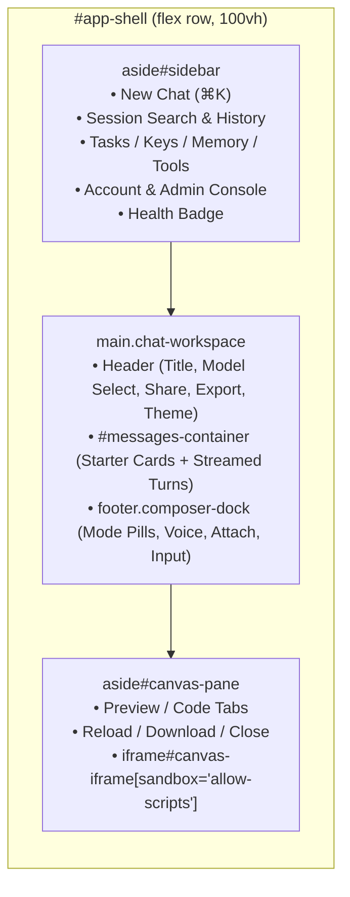

# Chapter 7 — Zero-Build Streaming SPA, Stop/Regenerate & the CSP-Sandboxed Grok Canvas

> **Source Files Covered:** [`frontend/index.html`](../../frontend/index.html) · [`frontend/app.js`](../../frontend/app.js) · [`frontend/styles.css`](../../frontend/styles.css) · [`frontend/manifest.json`](../../frontend/manifest.json) · [`frontend/sw.js`](../../frontend/sw.js)

In Chapters 1 through 6, we built a streaming FastAPI backend capable of reasoning (`<think>`), executing built-in and MCP tools, running iterative `DeepSearch`, recalling memories and document chunks, and routing across local Mac and cloud LLMs. Now we need a browser workspace worthy of that engine.

Most modern AI web apps pull in hundreds of megabytes of `node_modules`, bundler configs, and state-management frameworks just to render a chat stream. In Grok Bot, we took a deliberate **Zero-Build Vanilla ES2022** approach: [`frontend/index.html`](../../frontend/index.html), [`frontend/app.js`](../../frontend/app.js), and [`frontend/styles.css`](../../frontend/styles.css) are served directly by FastAPI with zero compilation step, instant reload, and complete auditability.

---

## 1. Layout Architecture: Three-Column Workspace

In [`frontend/index.html`](../../frontend/index.html), the application shell (`#app-shell`) is a three-column flex row:



Here is the Grok Studio / Canvas side-pane markup in `frontend/index.html` (lines 275–302):

```html
    <!-- Grok Studio / Canvas Preview Side-Pane -->
    <aside id="canvas-pane" class="canvas-pane hidden" aria-label="Grok Canvas Preview">
      <header class="canvas-header">
        <div class="canvas-header-left">
          <span class="canvas-badge">✨ Canvas</span>
          <strong id="canvas-title">Live Preview</strong>
        </div>
        <div class="canvas-header-actions">
          <div class="persona-segmented" role="group" aria-label="Canvas View">
            <button id="canvas-tab-preview" type="button" class="persona-btn active">Preview</button>
            <button id="canvas-tab-code" type="button" class="persona-btn">Code</button>
          </div>
          <button id="canvas-reload-btn" type="button" class="ghost-sm-btn" title="Reload preview">↻ Reload</button>
          <button id="canvas-download-btn" type="button" class="ghost-sm-btn" title="Download artifact">⬇ Download</button>
          <button id="canvas-close-btn" type="button" class="icon-btn" title="Close Canvas" aria-label="Close Canvas">✕</button>
        </div>
      </header>
      <div class="canvas-body">
        <iframe
          id="canvas-iframe"
          class="canvas-iframe"
          sandbox="allow-scripts"
          referrerpolicy="no-referrer"
          title="Grok Studio Sandboxed Preview"
        ></iframe>
        <pre id="canvas-code-view" class="canvas-code-view hidden"></pre>
      </div>
    </aside>
```

---

## 2. Streaming SSE Consumption with `ReadableStream`

Why doesn't Grok Bot use the browser's built-in `EventSource` API for chat?
Because `EventSource` only supports `GET` requests without a request body. A chat turn requires a `POST /api/chat` JSON payload carrying `session_id`, `message`, `model`, `persona`, `think`, `deepsearch`, `file_ids`, and base64 `images`—plus an `AbortController` signal so the **■ Stop** button (or `Escape` key) can abort generation immediately.

Here is the streaming SSE reader loop from `frontend/app.js` (lines 1037–1060):

```javascript
      const reader = res.body.getReader();
      const decoder = new TextDecoder();
      let buffer = "";

      while (true) {
        const { value, done } = await reader.read();
        if (done) break;
        buffer += decoder.decode(value, { stream: true });

        let boundary;
        while ((boundary = buffer.indexOf("\n\n")) !== -1) {
          const rawEvent = buffer.slice(0, boundary);
          buffer = buffer.slice(boundary + 2);

          for (const line of rawEvent.split("\n")) {
            if (!line.startsWith("data:")) continue;
            const jsonStr = line.slice(5).trim();
            if (!jsonStr) continue;
            let ev;
            try {
              ev = JSON.parse(jsonStr);
            } catch {
              continue;
            }
```

### Why the `\n\n` Buffer Loop Matters
TCP packets do not respect SSE event boundaries: a single `reader.read()` call may contain half of a JSON payload or three concatenated `data: {...}\n\n` events at once. Accumulating decoded text in `buffer` and slicing only at complete `\n\n` delimiters guarantees that no token is dropped and partial JSON never throws a parse error.

---

## 3. Real-Time `<think>` Extraction and XSS-Safe Markdown

Reasoning models like `qwen3.6:35b` or DeepSeek R1 often emit `<think>...</think>` tags inside the content stream, while reasoning APIs may also emit explicit `{"type": "think"}` SSE deltas.

`extractThinkTags(rawText)` handles both **closed** `<think>...</think>` blocks and **still-streaming** unclosed `<think>` prefixes:

`frontend/app.js` (lines 185–203):

```javascript
  function extractThinkTags(rawText) {
    let thinkParts = [];
    let cleaned = String(rawText || "");
    const closedRe = /<think>([\s\S]*?)<\/think>/gi;
    cleaned = cleaned.replace(closedRe, (_, inner) => {
      if (inner.trim()) thinkParts.push(inner.trim());
      return "";
    });
    const openIdx = cleaned.indexOf("<think>");
    if (openIdx !== -1) {
      const trailing = cleaned.slice(openIdx + 7);
      if (trailing.trim()) thinkParts.push(trailing.trim());
      cleaned = cleaned.slice(0, openIdx);
    }
    return {
      think: thinkParts.join("\n\n"),
      content: cleaned.trimStart(),
    };
  }
```

And `renderMarkdown(mdText)` extracts fenced code blocks first, escapes all untrusted HTML, and injects a **✨ Preview in Canvas** button whenever a code block is tagged `html`, `htm`, or `svg`:

`frontend/app.js` (lines 206–231):

```javascript
  function renderMarkdown(mdText) {
    if (!mdText) return "";
    const codeBlocks = [];
    let text = String(mdText).replace(/```([a-zA-Z0-9_+-]*)\n([\s\S]*?)```/g, (_, lang, code) => {
      const idx = codeBlocks.length;
      const rawLang = (lang || "code").toLowerCase();
      const safeLang = escapeHtml(lang || "code");
      const safeCode = escapeHtml(code.replace(/\n$/, ""));
      const isCanvasable = rawLang === "html" || rawLang === "htm" || rawLang === "svg";
      const previewBtn = isCanvasable
        ? `<button type="button" class="canvas-open-btn" data-preview-canvas="${idx}" data-canvas-lang="${escapeHtml(rawLang)}">✨ Preview in Canvas</button>`
        : "";
      codeBlocks.push(
        `<div class="code-block-wrapper">` +
          `<div class="code-block-header">` +
            `<span>${safeLang}</span>` +
            `<div class="code-header-actions">` +
              previewBtn +
              `<button type="button" class="copy-code-btn" data-copy-code="${idx}">Copy</button>` +
            `</div>` +
          `</div>` +
          `<pre class="code-block-pre"><code>${safeCode}</code></pre>` +
        `</div>`
      );
      return `\u0000CODEBLOCK_${idx}\u0000`;
    });
```

---

## 4. Defense-in-Depth: CSP-Locked Grok Canvas

Rendering model-generated HTML/JS inside the browser requires strict isolation so generated scripts—even if influenced by a prompt injection from a fetched web page—can **never** access cookies, `localStorage`, `/api/*` endpoints, or the network.

`frontend/app.js` (lines 1473–1498):

```javascript
  // Grok Studio / Canvas Preview Side-Pane
  const CANVAS_CSP_META =
    `<meta http-equiv="Content-Security-Policy" content="default-src 'none'; script-src 'unsafe-inline'; style-src 'unsafe-inline'; img-src data: blob:; font-src data:">`;

  function buildCanvasSrcdoc(rawCode, lang) {
    const code = String(rawCode || "");
    if (lang === "svg") {
      return `<!DOCTYPE html><html><head><meta charset="utf-8">${CANVAS_CSP_META}<style>html,body{margin:0;height:100%;display:flex;align-items:center;justify-content:center;background:#0f172a;color:#f8fafc;font-family:system-ui,sans-serif;}svg{max-width:95vw;max-height:95vh;}</style></head><body>${code}</body></html>`;
    }
    if (/<head[\s>]/i.test(code)) {
      return code.replace(/<head([\s>])/i, `<head$1${CANVAS_CSP_META}`);
    }
    return `<!DOCTYPE html><html><head><meta charset="utf-8">${CANVAS_CSP_META}</head><body>${code}</body></html>`;
  }

  function openCanvas(code, lang = "html") {
    state.canvasCode = String(code || "");
    state.canvasLang = (lang || "html").toLowerCase();
    if (el.canvasLangBadge) el.canvasLangBadge.textContent = state.canvasLang.toUpperCase();
    if (el.canvasCodeView) el.canvasCodeView.textContent = state.canvasCode;
    if (el.canvasIframe) {
      el.canvasIframe.srcdoc = buildCanvasSrcdoc(state.canvasCode, state.canvasLang);
    }
    setCanvasTab("preview");
    el.canvasPane?.classList.remove("hidden");
  }
```

1. **Opaque Origin (`sandbox="allow-scripts"` without `allow-same-origin`):** The iframe runs in a unique null origin, blocking `document.cookie`, `localStorage`, and `window.parent.document`.
2. **Inline CSP (`default-src 'none'`):** Blocks all outbound `fetch()`, `XMLHttpRequest`, WebSocket, and external image/script/beacon requests while allowing self-contained inline scripts and styles to run.

---

## 5. Try it

Run the static asset and Playwright headless Chrome E2E suite, which exercises the SPA, signup, admin invite creation, streaming chat, regenerate, API key creation, scheduled task execution, and the CSP-sandboxed Canvas preview:

```bash
.venv/bin/pytest tests/test_frontend.py -v
```

Real output:
```text
tests/test_frontend.py::test_frontend_static_assets_mounted PASSED       [ 20%]
tests/test_frontend.py::test_mlx_stt_server_routes PASSED                [ 40%]
tests/test_frontend.py::test_mlx_llm_server_routes_and_tool_protocol PASSED [ 60%]
tests/test_frontend.py::test_cli_single_turn_and_formatting PASSED       [ 80%]
tests/test_frontend.py::test_playwright_browser_e2e PASSED               [100%]
============================== 5 passed in 2.64s ===============================
```

---

## 6. Exercises

1. **Live Streaming Canvas Auto-Update:** Currently, the user clicks **✨ Preview in Canvas** after or during a fenced `html` block. Modify `updateAssistantMarkdownDOM()` in `frontend/app.js` so that if `#canvas-pane` is already open while an assistant message is streaming an `html` code block, `el.canvasCodeView` updates live and `el.canvasIframe.srcdoc` refreshes when the closing ```` ``` ```` fence arrives.
2. **Mermaid Diagram Preview:** Extend `isCanvasable` in `renderMarkdown()` (`frontend/app.js`) to support `rawLang === "mermaid"` by rendering simple flowcharts into SVG inside `#canvas-iframe`.

---

[← Chapter 6: Production Ops, Backups, Metrics & Evals](ch06-ops-backups-metrics-and-evals.md) · [Book Index](README.md) · [Chapter 8: Admin Console, Scheduled Tasks & API Keys →](ch08-admin-tasks-keys-and-portability.md)
