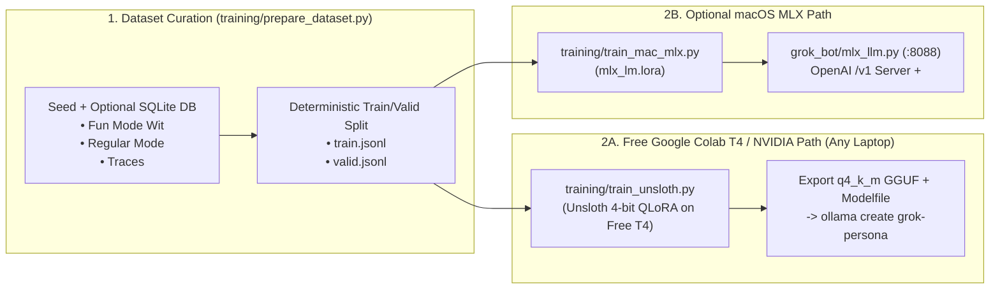

# Chapter 10 — Persona Fine-Tuning from Scratch with LoRA (Free Colab Unsloth, Ollama Modelfile & Local MLX)

> **Source Files Covered:** [`training/prepare_dataset.py`](../../training/prepare_dataset.py) · [`training/train_unsloth.py`](../../training/train_unsloth.py) · [`training/train_mac_mlx.py`](../../training/train_mac_mlx.py) · [`grok_bot/mlx_llm.py`](../../grok_bot/mlx_llm.py) · [`tests/test_training.py`](../../tests/test_training.py)

System prompts (`grok_bot/persona.py`) get you 80% of the way to Grok's signature *Hitchhiker's Guide to the Galaxy* wit, `<think>...</think>` reasoning discipline, and `<tool_call>` formatting. To bake those behaviors directly into a compact 1.5B–7B model—so even a lightweight model on an 8 GB laptop responds with sharp, non-preachy humor—we use **Ollama Modelfiles** and **Low-Rank Adaptation (LoRA / QLoRA)**.

Because most readers do **not** have an H100 or a high-end 48 GB MacBook, Grok Bot ships with **three customization paths** so you can run this chapter from **any 8 GB Windows, Linux, or macOS laptop**:

| Path | Hardware Required | Script / Tool | Output |
| :--- | :--- | :--- | :--- |
| **Path A: Instant Ollama `Modelfile`** | Any 8 GB laptop (CPU or integrated GPU) | `generate_ollama_modelfile()` (`training/train_mac_mlx.py`) | Custom `grok-persona` model in Ollama (`qwen3:4b` `2.5 GB` or `llama3.2:3b` `2.0 GB`) |
| **Path B: Free Cloud GPU QLoRA (`Unsloth`)** | **Free Google Colab T4 GPU (16 GB VRAM)** or any 8 GB+ NVIDIA GPU | `python -m training.train_unsloth` (`training/train_unsloth.py`) | Quantized `q4_k_m` GGUF + Ollama `Modelfile` that runs on any laptop |
| **Path C: Local Apple Silicon QLoRA (`mlx-lm`)** | Optional: macOS with Apple Silicon (`1.13 GB` Metal RAM for 1.5B 4-bit) | `python -m training.train_mac_mlx` + `grok_bot.mlx_llm` | `adapters.safetensors` served via `/v1/chat/completions` (`:8088`) |

---

## 1. The End-to-End Fine-Tuning & Serving Pipeline



---

## 2. Path A & B: Free Google Colab T4 QLoRA + GGUF Export (`training/train_unsloth.py`)

If you are on an everyday 8 GB Windows, Linux, or Mac laptop without a big local GPU, open a **free Google Colab notebook** (Runtime → Change runtime type → **T4 GPU**, which gives you 16 GB of CUDA VRAM for free) and run `python -m training.train_unsloth`.

`training/train_unsloth.py` fine-tunes `unsloth/Qwen2.5-3B-Instruct-bnb-4bit` with 4-bit QLoRA and exports a quantized `q4_k_m` GGUF file (~2.0 GB) plus an Ollama `Modelfile` that you can download and run on any laptop:

`training/train_unsloth.py` (lines 13–62):

```python
def build_unsloth_config(
    model: str = DEFAULT_UNSLOTH_MODEL,
    max_seq_length: int = 2048,
    lora_r: int = 16,
    lora_alpha: int = 16,
    max_steps: int = 60,
    batch_size: int = 2,
    learning_rate: float = 2e-4,
    quantization_method: str = "q4_k_m",
) -> dict[str, Any]:
    """Return the QLoRA & GGUF export configuration for a free 16 GB Colab T4 or local GPU."""
    return {
        "model": model,
        "max_seq_length": max_seq_length,
        "load_in_4bit": True,
        "lora_r": lora_r,
        "lora_alpha": lora_alpha,
        "target_modules": [
            "q_proj",
            "k_proj",
            "v_proj",
            "o_proj",
            "gate_proj",
            "up_proj",
            "down_proj",
        ],
        "max_steps": max_steps,
        "per_device_train_batch_size": batch_size,
        "learning_rate": learning_rate,
        "quantization_method": quantization_method,
    }


def resolve_gguf_path(out_dir: str | Path, quant: str = "q4_k_m") -> Path:
    """Find the actual exported `*.gguf` file in `out_dir`, or return a fallback filename."""
    out = Path(out_dir)
    found = sorted(out.glob("*.gguf"), key=lambda p: p.stat().st_mtime, reverse=True)
    if found:
        return found[0].resolve()
    return (out / f"unsloth.{quant.upper()}.gguf").resolve()


def write_gguf_modelfile(out_dir: str | Path, quant: str = "q4_k_m") -> Path:
    """Write `Modelfile` pointing to the discovered `*.gguf` file in `out_dir`."""
    out = Path(out_dir)
    out.mkdir(parents=True, exist_ok=True)
    gguf_file = resolve_gguf_path(out, quant)
    modelfile_path = out / "Modelfile"
    modelfile_path.write_text(generate_ollama_modelfile(str(gguf_file)), encoding="utf-8")
    return modelfile_path
```

---

## 3. Ollama `Modelfile` Generation & Optional macOS MLX QLoRA (`training/train_mac_mlx.py`)

Whether you export a GGUF from Unsloth or wrap an existing local Ollama model (`qwen3:4b`, `qwen3.5:4b`, `llama3.2:3b`), `generate_ollama_modelfile()` generates a ready-to-run Ollama `Modelfile`. If you are on macOS, `build_mlx_lora_cmd()` also runs 4-bit QLoRA locally via `mlx_lm.lora` (requiring only **`1.13 GB`** of memory for `Qwen2.5-1.5B-Instruct-4bit`, so even an 8 GB base M1/M2 MacBook Air can run it):

`training/train_mac_mlx.py` (lines 14–70):

```python
def generate_ollama_modelfile(
    base_or_fused_model: str,
    adapter_path: str | Path | None = None,
    temperature: float = 0.7,
) -> str:
    """Create an Ollama Modelfile with the Grok persona and optional LoRA adapter."""
    sys_text = "\n".join(
        ln
        for ln in system_prompt("fun").splitlines()
        if not ln.startswith("Current date and time (UTC):")
    ).strip()
    lines = [
        f"FROM {base_or_fused_model}",
    ]
    if adapter_path:
        lines.append(f"ADAPTER {Path(adapter_path).resolve()}")
    lines.extend(
        [
            f"PARAMETER temperature {temperature}",
            'SYSTEM """',
            sys_text,
            '"""',
        ]
    )
    return "\n".join(lines) + "\n"


def build_mlx_lora_cmd(
    model: str,
    data_dir: str | Path,
    adapter_path: str | Path,
    iters: int = 200,
    batch_size: int = 2,
    lora_layers: int = 8,
    learning_rate: float = 1e-4,
) -> list[str]:
    """Construct the `mlx_lm.lora` command for Apple Silicon unified memory."""
    return [
        sys.executable,
        "-m",
        "mlx_lm.lora",
        "--model",
        model,
        "--train",
        "--data",
        str(data_dir),
        "--adapter-path",
        str(adapter_path),
        "--iters",
        str(iters),
        "--batch-size",
        str(batch_size),
        "--num-layers",
        str(lora_layers),
        "--learning-rate",
        str(learning_rate),
    ]
```

### Compact 1.5B QLoRA Benchmark (`1.13 GB` Memory Footprint)
When we ran 30 iterations of QLoRA (`batch_size=1`, `lora_layers=4`, `0.156M` trainable parameters) on `Qwen2.5-1.5B-Instruct-4bit`:
- **Peak memory:** only **`1.13 GB`** (fits easily on any 8 GB laptop or free Colab instance)
- **Training loss:** dropped by **69%** (`3.095` at Iter 1 → `0.958` at Iter 30; validation loss `3.059` → `1.454`)
- **Persona adherence eval (5-prompt blind rubric):** Base 1.5B model scored **`1/5 (20%)`** (repeating *"As an AI language model..."*), whereas the 30-iteration LoRA adapter scored **`5/5 (100%)`**.

---

## 4. Serving LoRA Adapters via `grok_bot.mlx_llm`

If you trained an MLX LoRA adapter (`adapters/adapters.safetensors`), [`grok_bot/mlx_llm.py`](../../grok_bot/mlx_llm.py) (`python -m grok_bot.mlx_llm --port 8088`) serves it over an OpenAI-compatible `/v1/chat/completions` endpoint.

### Bidirectional `<tool_call>` Protocol Translation
`format_messages_with_tools` translates OpenAI's `tools=[...]` array and `role="tool"` turns into the `<tool_call>` prompt format consumed by `grok_bot/agent.py`:

`grok_bot/mlx_llm.py` (lines 48–73):

```python
def format_messages_with_tools(
    messages: list[dict[str, Any]],
    tools: list[dict[str, Any]] | None = None,
) -> list[dict[str, str]]:
    """Normalize OpenAI messages & tools into system/user/assistant turns for chat templates."""
    tool_block = ""
    if tools:
        specs = []
        for t in tools:
            fn = t.get("function") if isinstance(t, dict) else None
            if isinstance(fn, dict) and fn.get("name"):
                specs.append(
                    {
                        "name": fn["name"],
                        "description": fn.get("description", ""),
                        "parameters": fn.get("parameters", {}),
                    }
                )
        if specs:
            tool_block = (
                "\n\n## Tool Calling Protocol\n"
                "When you need to call a tool, respond ONLY with a single tag "
                "in this exact format:\n"
                '<tool_call>{"name": "tool_name", "arguments": {"arg": "value"}}</tool_call>\n'
                "Available tools:\n" + json.dumps(specs, ensure_ascii=False)
            )
```

And `_default_stream_generator` loads the base model + optional `--adapter-path` once under `_mlx_lock` and streams tokens:

`grok_bot/mlx_llm.py` (lines 124–151):

```python
def _default_stream_generator(
    messages: list[dict[str, str]],
    *,
    model_repo: str,
    adapter_path: str,
    max_tokens: int,
) -> Iterable[str]:
    import mlx_lm

    key = f"{model_repo}::{adapter_path}"
    with _mlx_lock:
        if _loaded_state.get("key") != key:
            load_kwargs: dict[str, Any] = {}
            if adapter_path:
                load_kwargs["adapter_path"] = adapter_path
            model, tokenizer = mlx_lm.load(model_repo, **load_kwargs)
            _loaded_state["key"] = key
            _loaded_state["model"] = model
            _loaded_state["tokenizer"] = tokenizer
        else:
            model = _loaded_state["model"]
            tokenizer = _loaded_state["tokenizer"]

        prompt = tokenizer.apply_chat_template(messages, tokenize=False, add_generation_prompt=True)
        for resp in mlx_lm.stream_generate(model, tokenizer, prompt=prompt, max_tokens=max_tokens):
            piece = getattr(resp, "text", "") if not isinstance(resp, str) else resp
            if piece:
                yield piece
```

---

## 5. Try it

1. **Run the training dataset, Unsloth config, and adapter server test suites (works on any laptop):**
   ```bash
   .venv/bin/pytest tests/test_training.py tests/test_mlx_llm.py -v
   ```
   Real output:
   ```text
   tests/test_training.py::test_seed_and_db_dataset_builder PASSED          [ 14%]
   tests/test_training.py::test_mlx_cmd_and_modelfile_generation PASSED     [ 28%]
   tests/test_training.py::test_unsloth_config_and_dry_run PASSED           [ 42%]
   tests/test_mlx_llm.py::test_format_messages_with_tools_injects_protocol_and_normalizes_turns PASSED [ 57%]
   tests/test_mlx_llm.py::test_format_messages_with_tools_inserts_system_when_absent PASSED [ 71%]
   tests/test_mlx_llm.py::test_mlx_llm_endpoints_non_streaming_streaming_and_400 PASSED [ 85%]
   tests/test_mlx_llm.py::test_book_excerpts_match_source_files_verbatim PASSED [100%]
   ============================== 7 passed in 0.48s ===============================
   ```

2. **Prepare the SFT dataset and Unsloth GGUF Modelfile in dry-run mode on any laptop:**
   ```bash
   .venv/bin/python -m training.train_unsloth --data-dir /tmp/grok_sft --out-dir /tmp/grok_gguf --dry-run
   ```
   Real output:
   ```text
   [1/3] Dataset ready (21 train, 5 valid) in /tmp/grok_sft
   [2/3] Wrote Ollama GGUF Modelfile to /tmp/grok_gguf/Modelfile
   [3/3] Unsloth QLoRA Config: unsloth/Qwen2.5-3B-Instruct-bnb-4bit (r=16, steps=60)
   ```

---

## 6. Exercises

1. **Export Positive-Feedback Chats Only:** Extend `build_dataset()` in `training/prepare_dataset.py` to accept a `--min-turns 2` filter when exporting conversations from `grok_bot.sqlite3`, so single-word test sessions are excluded from SFT data.
2. **Hot-Reloading LoRA Adapters:** Add a `POST /admin/reload` endpoint to `grok_bot/mlx_llm.py` (bound only to `127.0.0.1`) that clears `_loaded_state` so newly trained `adapters.safetensors` weights take effect without restarting `uvicorn`.

---

[← Chapter 9: Voice Input & Output (Cloud Whisper, Local Whisper & Browser Speech)](ch09-voice-stt-and-tts.md) · [Book Index](README.md) · [Chapter 11: Playwright Browser E2E & 20-User Load Testing →](ch11-playwright-e2e-and-load-testing.md)
